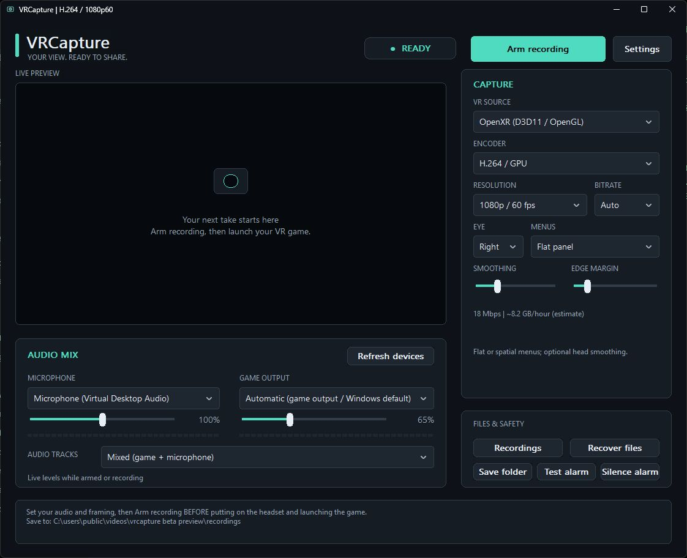

# VRCapture

**PCVR recording, built for creators.** By thefreemike.

Arm on your desktop, put on your headset, and launch your game. VRCapture records supported VR images and your commentary, then saves when you leave the game. No OBS setup required.

**Beta 0.1.0-beta.3 · Windows x64 · Closed source**

[Download the beta](https://github.com/thefreemike31/VRCapture/releases) · [Start here](docs/quick-start.md) · [Audio & editing](docs/audio-and-editing.md) · [Wrist controls](docs/wrist-panel.md) · [Troubleshooting](docs/troubleshooting.md)

## What you can do

- Record at 1080p, 1440p, 4K or 2560×1080 ultrawide, targeting 60 fps, with H.264, HEVC or AV1 hardware encoding where supported by your GPU.
- Choose **Full view (keep hands visible)** to retain the complete submitted eye image with bars where needed, or **Fill** for a widescreen crop. Quest 3 and Native source always use Full view.
- Capture 32-bit and 64-bit OpenXR games using D3D11/OpenGL, or use the SteamVR compositor source.
- Adjust microphone and game volume independently. Save a mixed track plus separate microphone and game tracks for editing.
- See the selected microphone on a wrist panel and change it before or during recording. Use smoother head aiming and dwell controls to arm, stop and confirm.
- See desktop/wrist warnings during recording, hear setup and post-capture failure alarms, and recover saved components after an interruption.

## Your first take

**New in beta.3:** Change the microphone from the wrist panel, with a more responsive aiming dot. Recording warnings stay silent so recorder tones cannot enter your audio. Capture avoids redundant queued-frame copies and skips the desktop preview when minimized; reports include more timing information for diagnosing stutters. These improvements do not guarantee stutter-free gameplay on every setup.

To update, close your game and VRCapture, then extract the complete ZIP over your existing installation. Keep your `capture-settings.ini` and recordings; the ZIP contains neither. If you move to a new folder, follow the relocation steps in the [quick-start guide](docs/quick-start.md).

1. Download the release ZIP and **extract everything** to a permanent, writable folder.
2. Close other copies of VRCapture and run **Test recording.cmd**. Play its generated demo to check encoding and saving.
3. Connect your headset, open **VRCapture.exe**, and choose the capture source and microphone. Start with **H.264 / 1080p60 / Auto bitrate**.
4. Click **Arm recording**, wait for **ARMED**, then launch your game. The first OpenXR setup may request Windows administrator approval.
5. Make a short take with speech, gameplay and a menu. Exit the game, let saving finish, and check the MP4 before a longer session.

For F.E.A.R. VR, choose **OpenXR**, including when SteamVR is its runtime. The **SteamVR / OpenVR** source is a separate compositor capture method; it includes visible SteamVR overlays in the video. See the [source guide](docs/quick-start.md#choose-your-capture-source).

## Compatibility and beta limits

Requires Windows 10/11 x64, a working PCVR setup, Windows Media Foundation and a compatible hardware encoder. Windows N editions may need the Media Feature Pack. The recorder and game must use the same GPU. No separate OBS, Python, FFmpeg or C++ runtime installation is needed.

OpenXR capture currently supports D3D11 and OpenGL; D3D12/Vulkan OpenXR and native Oculus SDK capture are not implemented. OpenGL needs compatible `WGL_NV_DX_interop2` support. SteamVR capture uses its compositor mirror and has different framing/overlay limits. Standalone Quest games and Quest/Virtual Desktop system UI are outside this PC capture path.

This beta has been used for real gameplay recordings, but hardware, games and runtimes vary. Test your own setup. Recovery can preserve media already saved; it cannot reconstruct unsaved footage or guarantee against recording loss. Check desktop/wrist warnings promptly; alerts stay silent while recording to keep them out of your audio. The app is currently unsigned.

## Downloads, feedback and source

This repository hosts **release downloads, user guides and issue reports**. VRCapture's application source is not published. You can use the beta to make personal or monetized videos; see [the license](LICENSE.txt).

For a problem, include your version, GPU, headset connection, game, capture source, settings and a short reproduction. Review diagnostic text before attaching it: it can contain local paths and audio-device names. Do not upload full recordings unless you intend to share them.

VRCapture bundles a separate [FFmpeg](https://ffmpeg.org/) helper under LGPL 2.1 or later. Its corresponding source and build instructions are included in each [release ZIP](https://github.com/thefreemike31/VRCapture/releases), under `tools/source`. OpenVR and OpenXR notices are also included. These components retain their own licenses; see [third-party notices](THIRD-PARTY-NOTICES.txt).
