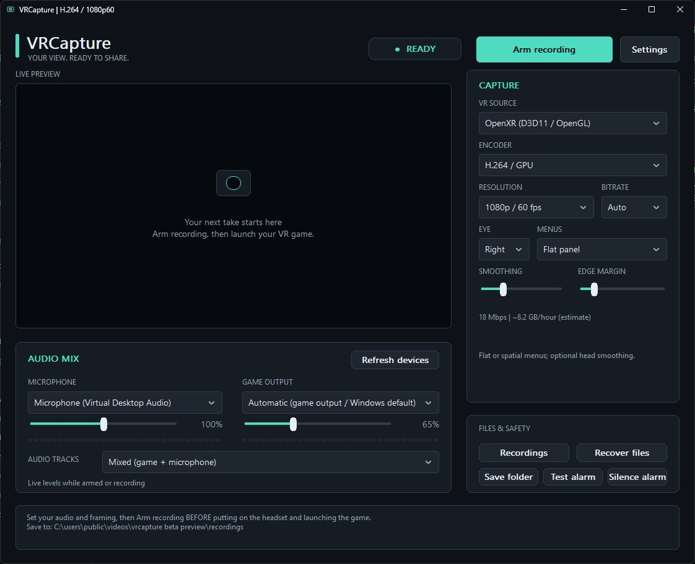

# VRCapture

**PCVR recording, built for creators.** By thefreemike.

Arm on your desktop, put on your headset, and launch your game. VRCapture records supported VR images and your commentary, then saves when you leave the game. No OBS setup required.

**0.1.0-beta.8 · Windows x64 · Closed source**

**New in beta.8:** native OpenXR **Vulkan capture and wrist controls**, plus **presenter notes** on a separate wrist sheet. Keep VDXR as your runtime and use Auto or OpenXR capture. Read [presenter setup](docs/presenter-notes.md) and [capture sources](docs/quick-start.md#choose-your-capture-source).

[Download the beta](https://github.com/thefreemike31/VRCapture/releases) · [Start here](docs/quick-start.md) · [Audio & editing](docs/audio-and-editing.md) · [Wrist controls](docs/wrist-panel.md) · [Troubleshooting](docs/troubleshooting.md)

## What you can do

- Record at 1080p, 1440p, 4K or 2560×1080 ultrawide, targeting 60 fps, with H.264, HEVC or AV1 hardware encoding where supported by your GPU.
- Choose **Full view (keep hands visible)** to retain the complete submitted eye image with bars where needed, or **Fill** for a widescreen crop. Quest 3 and Native source always use Full view.
- Capture 32-bit and 64-bit OpenXR games using D3D11/D3D12/OpenGL/Vulkan, or use the SteamVR compositor source.
- Adjust microphone and game volume independently. Save a mixed track plus separate microphone and game tracks for editing.
- Pause and resume from the desktop or wrist panel, keeping one video file with paused picture and sound excluded.
- View the live preview fullscreen with **Fullscreen / F11** or a double-click. **Escape** returns to the controls without stopping a recording.
- See the selected microphone on a wrist panel and change it before or during recording. Use head aiming and dwell controls to arm, pause, resume, stop and confirm.
- Read multi-page talking points on another wrist, with Touch thumb-rest tap/hold controls or head-aimed navigation. OpenXR notes stay out of your recording.
- See desktop/wrist warnings during recording, hear setup and post-capture failure alarms, and recover saved components after an interruption.

## Your first take

**Also included from beta.5 — pause/resume, remembered camera settings and further performance improvements:** Skip a break or an unwanted section with **Pause**, then **Resume** into the same MP4. Smoothing and edge margin survive restart and upgrades that retain your settings file. OpenGL capture avoids a redundant image copy, and desktop preview presentation runs independently of recording, including during window resizing. Resolution, bitrate and audio-track choices stay the same.

The latest owner test completed roughly 55 minutes of Fallout: New Vegas VR using a modified OpenXR/Vulkan build through VDXR, recording at 4K60 AV1 and stopping from the wrist panel. The owner reported that it worked perfectly. Its reports show no encoder queue drops or audio faults, with two missed output slots and some repeated source images. Automated tests cover x86/x64 Vulkan capture, layers, menus, notes exclusion and the existing graphics paths. This validates the reported setup; other Vulkan games, engines, drivers and runtimes still need testing.

To update, close your game and VRCapture, then extract the complete ZIP over your existing installation. Keep your `capture-settings.ini`, `presenter-notes.txt` and recordings; the ZIP contains none of them. If you move to a new folder, follow the relocation steps in the [quick-start guide](docs/quick-start.md).

1. Download the release ZIP and **extract everything** to a permanent, writable folder.
2. Close other copies of VRCapture and run **Test recording.cmd**. Play its generated demo to check encoding and saving.
3. Connect your headset, open **VRCapture.exe**, choose **Auto (recommended)** for VR source, and select your microphone. Start with **H.264 / 1080p60 / Auto bitrate**.
4. Click **Arm recording**, wait for **ARMED**, then launch your game. The first OpenXR setup may request Windows administrator approval.
5. Make a short take with speech, gameplay and a menu. Exit the game, let saving finish, and check the MP4 before a longer session.

Auto prefers the OpenXR capture path for supported games such as F.E.A.R. VR, including when SteamVR is their runtime. It uses the SteamVR compositor when that is the available capture source. Manual source choices remain available. See the [source guide](docs/quick-start.md#choose-your-capture-source) for detection and overlay limits.

## Compatibility and beta limits

Requires Windows 10/11 x64, a working PCVR setup, Windows Media Foundation and a compatible hardware encoder. Windows N editions may need the Media Feature Pack. The recorder and game must use the same GPU. No separate OBS, Python, FFmpeg or C++ runtime installation is needed.

OpenXR capture supports D3D11, D3D12, OpenGL and Vulkan, including wrist controls and presenter notes. It captures 8-bit SDR RGBA/BGRA game images; HDR/10-bit/float capture and native Oculus SDK capture are not implemented. OpenGL needs compatible `WGL_NV_DX_interop2` support. Vulkan needs Vulkan 1.1+ with Windows external texture/fence sharing on the same GPU. SteamVR capture uses its compositor mirror and has different framing/overlay limits. Standalone Quest games and Quest/Virtual Desktop system UI are outside this PC capture path.

This beta has been used for real gameplay recordings, but hardware, games and runtimes vary. Test your own setup. Recovery can preserve media already saved; it cannot reconstruct unsaved footage or guarantee against recording loss. Check desktop/wrist warnings promptly; alerts stay silent while recording to keep them out of your audio. The app is currently unsigned.

## Downloads, feedback and source

This repository hosts **release downloads, user guides and issue reports**. VRCapture's application source is not published. You can use the beta to make personal or monetized videos; see [the license](LICENSE.txt).

For a problem, include your version, GPU, headset connection, game, capture source, settings and a short reproduction. Review diagnostic text before attaching it: it can contain local paths and audio-device names. Do not upload full recordings unless you intend to share them.

VRCapture bundles a separate [FFmpeg](https://ffmpeg.org/) helper under LGPL 2.1 or later. Its corresponding source and build instructions are included in each [release ZIP](https://github.com/thefreemike31/VRCapture/releases), under `tools/source`. OpenVR, OpenXR and Vulkan notices are also included. These components retain their own licenses; see [third-party notices](THIRD-PARTY-NOTICES.txt).
